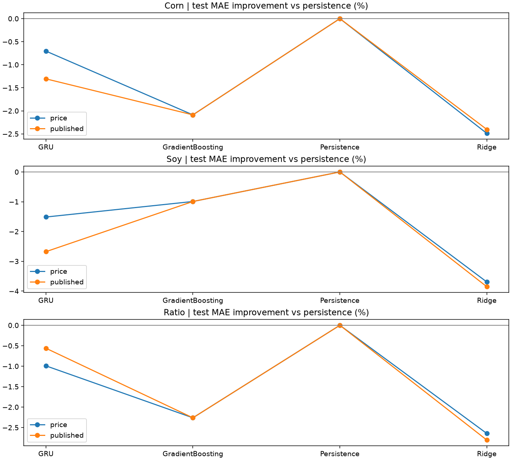

# Agricultural Forecast Validation

**Can corn and soybean forecasts beat persistence, and does lower forecast error produce tradable returns?**

A financial deep learning course project extended into a reproducible time-series validation study. The project compares simple baselines, Ridge, Gradient Boosting and GRU, audits information timing, and evaluates two-leg strategies after execution delay and transaction costs.

## Findings

| Experiment | Result |
|---|---|
| Next-observation price forecasts, 2023–May 2026 | Persistence had the lowest test MAE for corn, soybeans and their price ratio. |
| Annual model selection, 2018–May 2026 | The validation-selected strategy returned **−2.17%** after base costs, with **3 entries**. |
| Paired block-bootstrap MAE advantage | **−0.10 bp**, 95% interval **[−0.33, +0.13] bp** relative to zero holding-return forecasts. |
| Weekend-observation sensitivity | Selected-strategy return **−0.82%** after excluding 7 weekend observations and retraining. |
| Double-cost scenario | The selected strategy made zero entries. The higher entry threshold changes the trading decisions. |

The original single-split experiment produced a post-hoc best directional strategy return of +3.34%. The annual experiment changes the prediction target and evaluation period, so the difference cannot be attributed to one isolated change. The results support caution about forecasting value after timing and model-selection constraints.

## Design

- **Observed dates** — intersect the two source price files and retain positive prices.
- **Information timing** — use trailing features; delay drought data by seven days after its Tuesday observation date. Inputs with unverified release dates are diagnostic comparisons.
- **Forecast evaluation** — fit scalers on training inputs, select GRU checkpoints using validation MAE, and compare every model on the same target dates.
- **Tradable target** — a signal after close at t executes at the next observed close. Predict the equal-weight soy-long/corn-short return from that entry close to the following close.
- **Annual validation** — for each year from 2018, train on earlier years, select using the previous year and evaluate on that year. Purge labels overlapping the next partition's first signal.
- **Accounting** — equal gross leg weights, drift-aware rebalancing, costs on both legs, and terminal liquidation.
- **Uncertainty** — paired circular blocks of 20 observations, 2,000 resamples. Intervals condition on fitted models and the observed price series.



## Run

Tested on Windows with Python 3.11.9 and CPU PyTorch.

```bash
python -m venv .venv
# Activate the virtual environment, then:
python -m pip install -r requirements.txt
python smoke.py
```

`smoke.py` creates deterministic synthetic inputs in a temporary directory and checks the price calendar, causal features, sequence preparation and trading arithmetic. Synthetic inputs carry no empirical performance claims.

For the historical experiments, place the locally held source files in `data/` following [the input contract](data/README.md), then run:

```bash
python run.py
python verify.py
python walkforward.py
python walkforward.py --weekdays-only
```

Outputs are written to `results/`. For a different input location, pass `--data PATH`. The full Windows/Python 3.11 dependency snapshot is `requirements-win311.lock`.

## Results and documentation

- [Annual validation report — Korean](docs/순차검증.md)
- [Original price and strategy evaluation — Korean](docs/보고서.md)
- [Detailed methodology — Korean](docs/methodology.ko.md)
- [Independent-environment reproduction record — Korean](docs/reproducibility.ko.txt)
- [Annual metrics](results/walk_metrics.csv) and [weekdays-only sensitivity](results/walk_metrics_weekdays.csv)
- [Single-split forecast and strategy comparison](results/forecast_vs_strategy.csv)

## Scope and limitations

The source spreadsheets contain dates and prices without a documented provider, contract identifier, roll convention or redistribution terms. Historical raw inputs and row-level prediction ledgers are kept local. This repository publishes code and aggregate research results. Full historical reruns require those source inputs.

The source calendar includes repeated quotes and weekend observations. Contract rolls, financing, margins and actual futures fills are unresolved. All returns are simulated price-series results. The test history was already explored during the original project, so this is retrospective validation. Three selected-strategy entries provide limited evidence about profitability, and the bootstrap does not include model-refitting uncertainty.

The original project was a group course assignment. This repository contains the subsequent implementation and validation extension, developed with AI coding assistance and verified by executable checks. It does not establish a profitable trading strategy.
