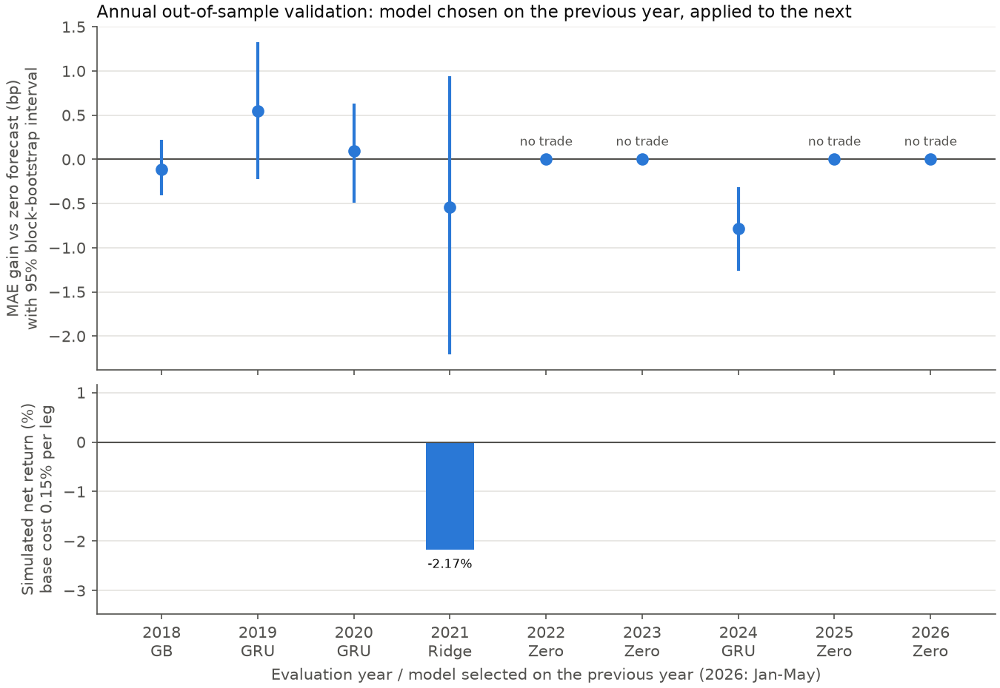
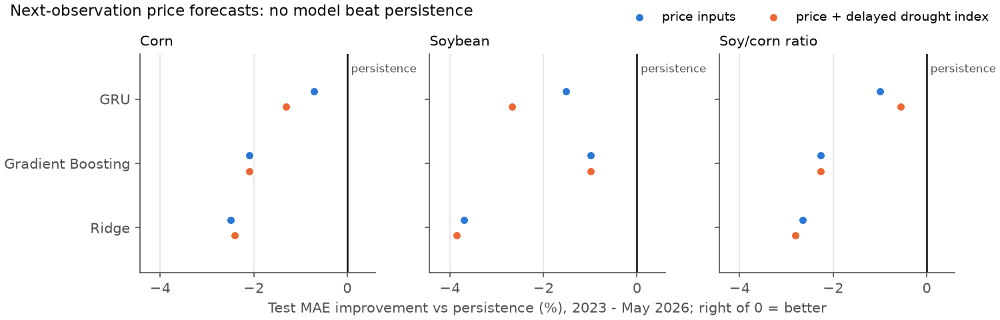

# Agricultural Forecast Validation

[](https://github.com/sooyahh/agri-forecast-validation/actions/workflows/checks.yml)

**Do corn and soybean price forecasts beat a persistence baseline, and does any predictive edge survive delayed execution and assumed trading costs?**

**Origin:** Ajou University · **Financial Deep Learning** · **Spring 2026 (first semester)** · group course project (analysis and implementation by me)  
**This repository:** My individual extension of that project, focused on time-series validation, information timing, simulated two-leg accounting, and reproducibility.

> **Main takeaway:** More complex forecasting models did not beat persistence. When the model was chosen each year using only earlier data, the simulated strategy traded in only one of nine years, entered 3 times, and ended at −2.17%. The value of this study is the validation and failure analysis, not a profitable strategy.

**한국어 요약** — 아주대 2026-1학기 '금융딥러닝' 4인 조별과제(분석·구현 본인)를 개인적으로 확장한 시계열 검증 연구입니다.

- 옥수수·대두 가격 예측에서 Ridge, Gradient Boosting, GRU 모두 직전 가격을 그대로 쓰는 기준(persistence)보다 오차가 작지 않았습니다.
- 매년 이전 데이터로만 모델을 고르게 하자 모의 전략은 9년 중 1년만 거래했고(진입 3회) 누적 −2.17%였습니다. 원 과제의 +3.34%는 테스트 결과를 본 뒤 고른 값이며, 두 실험은 목표와 기간이 달라 직접 비교하지 않습니다.
- 데이터 공개 시점 감사, 미래 데이터를 바꿔도 과거 예측 148,824개가 그대로인지 보는 누수 검사, 비용을 반영한 체결 회계, 입력 데이터 출처 감사를 설계하고 구현했습니다.
- 한국어 상세 문서: [연도별 검증 보고서](docs/annual_validation.ko.md) · [방법론](docs/methodology.ko.md) · [단일 분할 보고서](docs/single_split_report.ko.md)



## What this project demonstrates

- **Look-ahead test:** `verify.py` alters all prices and features from 2025 onward, refits every model, and confirms that all 148,824 earlier forecasts are unchanged.
- **Information timing audit:** the drought index is used only seven days after its Tuesday observation date; inputs without verifiable release dates are kept as diagnostics and excluded from model selection and trading.
- **Annual model selection with an abstain option:** each year's model is chosen on the previous year only, with a "predict zero, do not trade" candidate and purged partition boundaries.
- **Execution-aware accounting:** signals fill at the next observed close, costs apply to both legs, and a hand-calculated ledger test checks entries, reversals and liquidation.
- **Uncertainty and robustness:** paired block-bootstrap intervals, a doubled-cost scenario, and a weekdays-only calendar rerun.
- **Data source audit:** each input traced to its producer where possible and compared with official releases; the audit also exposed problems in the exploratory features, such as a spliced dollar index and marketing-year quarters read as calendar quarters ([details](docs/data-sources.md)).

## Project evolution and contribution

| Stage | Scope |
|---|---|
| **Original coursework (Spring 2026)** | Registered as a four-person group assignment in Financial Deep Learning at Ajou University. I carried out the coursework's data processing, modeling and analysis. |
| **This repository (individual)** | I reworked the evaluation around observed-date alignment, information availability, annual model selection, an execution-delayed return proxy, transaction-cost scenarios, uncertainty estimates and reproducibility checks. |

I designed the validation and implemented it with AI coding assistants. Every reported number is checked against executable tests and recorded outputs.

## What was tested

1. **Price prediction:** Compare persistence, Ridge, Gradient Boosting, and GRU for next-observation corn, soybean, and soy/corn ratio prices.
2. **Information timing:** Use historical price features and a conservatively delayed drought index; treat variables without verifiable release dates as diagnostic only.
3. **Simulation after model selection:** Select models using earlier periods, predict a two-leg holding-return proxy, delay assumed fills until the next observed close, and account for assumed rebalancing costs.
4. **Robustness and uncertainty:** Check a weekdays-only calendar, doubled-cost scenario, and paired block-bootstrap error intervals.

## Findings

**Forecast accuracy:** In the 2023–May 2026 price-forecast test window, persistence had the lowest test MAE for corn, soybeans, and their price ratio. Adding the delayed drought index did not change that.



**Model selection and simulated trading:** The annual validation-selected strategy had a **−2.17% simulated net return** under the base cost assumption, with only **3 entries**, all in 2021. Doubling the assumed cost and its linked entry threshold resulted in **no entries**.

**Uncertainty:** Relative to predicting a zero two-leg holding return, the selected forecasts had a paired-bootstrap MAE advantage of **−0.10 bp** (95% interval **[−0.33, +0.13] bp**), so there is no reliable forecasting advantage.

| Additional check | Observed result |
|---|---|
| Exclude 7 weekend observations, retrain and reselect | **−0.82%** simulated net return for the selected strategy |
| Original single-split study: best directional strategy *chosen after viewing the test results* | **+3.34%** simulated net return (post-hoc, not an unbiased estimate) |

The single-split study and the annual extension use different prediction targets and evaluation periods, so their returns are not a controlled before/after comparison.

## Methodology

- **Observed dates** — intersect the two source price files and retain positive prices on shared dates.
- **Information timing** — use trailing features; delay drought data by seven days after its Tuesday observation date. Inputs with unverified release dates are *exploratory diagnostics*, not trading inputs.
- **Forecast evaluation** — fit scalers on training inputs, select GRU checkpoints using validation MAE, and compare models on common target dates.
- **Execution-aligned proxy** — generate a signal after close at time `t`; assume execution at the following observed close. Predict the equal-weight pair's return over the *subsequent* close-to-close period.
- **Annual validation** — for each test year from 2018, train using prior years, select using the previous year, and evaluate on that year. Purge labels overlapping the next partition's first signal.
- **Simulated accounting** — equal gross leg weights, drift-aware rebalancing, assumed costs on both legs (0.15% of traded notional per leg in the base case), and terminal liquidation.
- **Uncertainty** — paired circular blocks of 20 observations, 2,000 resamples. Intervals condition on the fitted models and observed quote series.

## Run

Tested on Windows with Python 3.11.9 and CPU PyTorch.

```bash
python -m venv .venv
# Activate the virtual environment, then:
python -m pip install -r requirements.txt
python smoke.py
python plots.py
```

`smoke.py` creates deterministic synthetic inputs in a temporary directory and checks the price calendar, causal features, sequence preparation and trading arithmetic. It does not reproduce the historical performance tables. `plots.py` redraws the README figures from the committed aggregate results.

For the historical experiments, place locally held source files in `data/` following [the input contract](data/README.md), then run:

```bash
python run.py
python verify.py
python walkforward.py
python walkforward.py --weekdays-only
python walkforward.py --nested-selection
python walkforward.py --nested-selection --weekdays-only
python compare_nested.py
```

Scripts write outputs under `results/`. For another input location, pass `--data PATH`. The full Windows/Python 3.11 dependency snapshot is `requirements-win311.lock`.

## Limitations

- **Data provenance:** the drought index, the only non-price input used for model selection and trading, matches the official U.S. Drought Monitor data service for all 6,078 state-week rows. The price spreadsheets only partially match public candidates (a Macrotrends-format archive and Yahoo Finance `ZC=F`/`ZS=F` closes), so their provider, contract months and roll rules remain unidentified. Raw inputs and row-level ledgers stay local, and the historical results cannot be rerun from this repository alone. See the [source-by-source audit](docs/data-sources.md).
- **Simulation, not trading:** returns are simulated NAV changes on the supplied quote series. The 0.15% cost is an assumption; spreads, slippage, rolls, margin and financing are not modeled.
- **Retrospective test:** the test period had already been examined during the coursework, and three entries are too few for any profitability inference.
- **Selection bias toward GRU:** GRU checkpoints and the annual model choice share one validation year. A nested check (`--nested-selection`: the earlier half picks checkpoints, the later half picks the model) leaves the headline unchanged: −2.17% with 3 entries and an MAE gain of −0.06 bp [−0.29, +0.16]. Yearly choices shift (GRU dropped in 2024; Zero → GB in 2022 and 2026), and the weekdays-only return falls from −0.82% to −2.17%. Each half has about 125 observations, so this check is itself noisy, and the bootstrap intervals exclude model-refitting uncertainty. See [the comparison](results/nested/comparison.md).

## Results and supporting documentation

- [Annual validation report — Korean](docs/annual_validation.ko.md)
- [Original price and strategy evaluation — Korean](docs/single_split_report.ko.md)
- [Detailed methodology — Korean](docs/methodology.ko.md)
- [Independent-environment reproduction record — Korean](docs/reproducibility.ko.txt)
- [Annual metrics](results/walk_metrics.csv) and [weekdays-only sensitivity](results/walk_metrics_weekdays.csv)
- [Single-split forecast and strategy comparison](results/forecast_vs_strategy.csv)

## License

[MIT](LICENSE)
